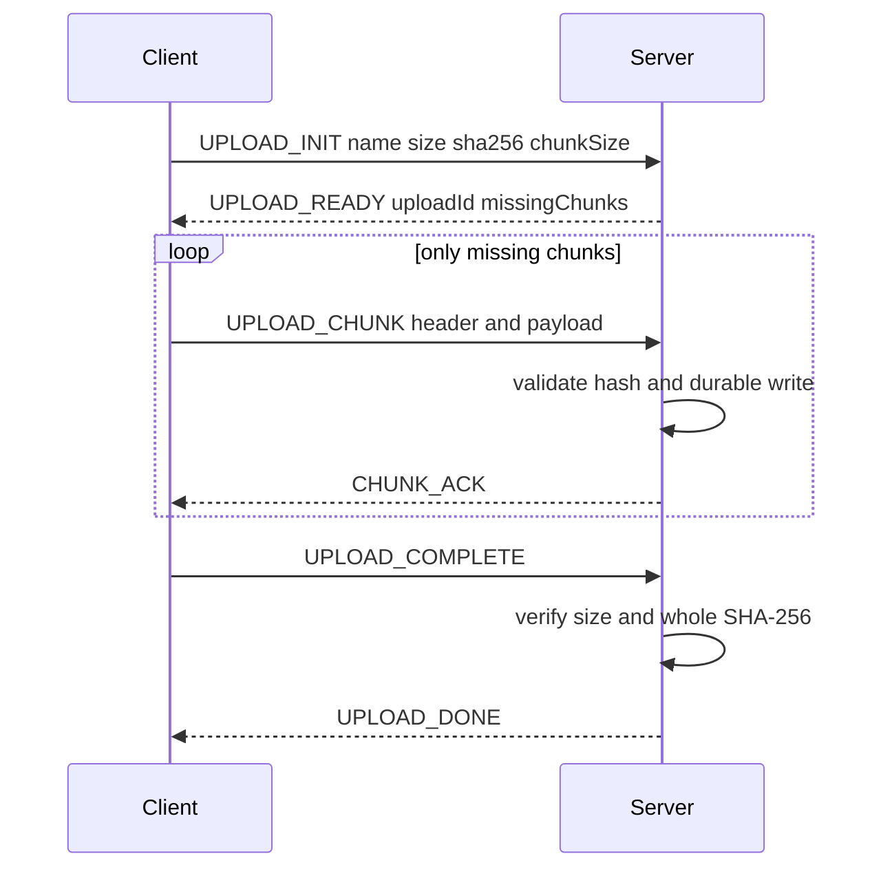
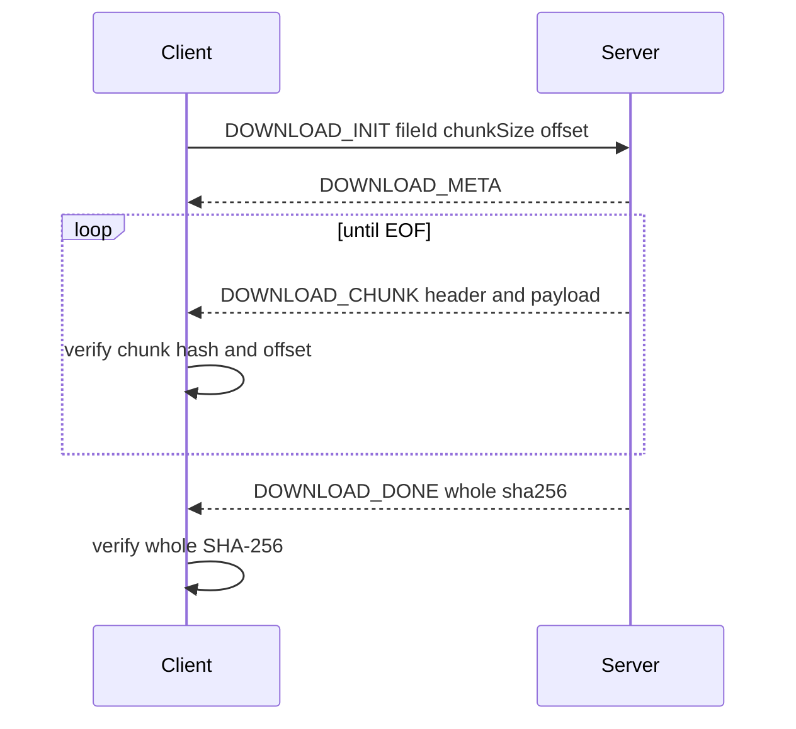

# SFT Protocol V1

## 传输帧

控制帧使用 UTF-8 JSON 文本。文件数据使用二进制帧：前 4 字节为大端无符号协议头长度，随后是 UTF-8 JSON 协议头，最后是原始载荷。协议头限制为 16 KiB，单个载荷限制为 4 MiB。

```text
 0                   31 32                       N              End
+----------------------+--------------------------+---------------+
| Header length uint32 | JSON header UTF-8        | Binary payload|
+----------------------+--------------------------+---------------+
```

所有请求包含 `v=1` 和随机 `requestId`。上传分块还包含 `uploadId`、`index`、`offset`、`size` 与分块 `sha256`。服务器同时验证消息上限、字段类型、序号、偏移、长度和哈希。

## 上传时序



客户端只有收到 `CHUNK_ACK` 才发送下一分块。连接中断后，客户端重新发送 `UPLOAD_INIT`；服务端按用户、文件名、大小和整文件哈希定位未完成会话，并仅返回缺失分块。

## 下载时序



`offset` 允许客户端从指定字节继续下载。Web 客户端在支持 File System Access API 的 Chromium 浏览器中直接流式写入用户选择的文件；连接中断时使用已持久写入的字节数作为新偏移，最多自动恢复三次。旧浏览器回退为内存组装，并对大于 256 MiB 的文件主动拒绝，以避免内存耗尽。

